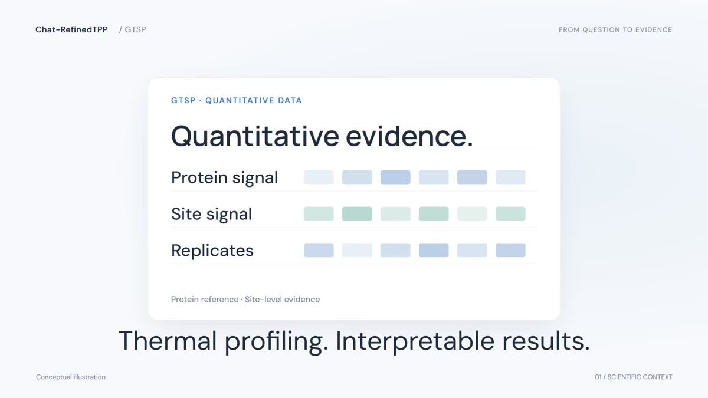

# Chat-RefinedTPP

**An AI Agent–Assisted Processing and Analysis Platform for TMT-based Refined-TPP Quantitative Data**

A task-specific agent harness for experimental design, quality control, analysis and evidence-linked interpretation.

**Principal Developer & Maintainer: Haoru Song (宋昊儒)**

[Website](https://chat-refinedtpp.com/) · [Watch the demo](https://chat-refinedtpp.com/#demo) · [Documentation](docs/README.md) · [Feedback](https://github.com/SongHaoru-max/Chat-RefinedTPP/issues/new/choose)

## 📖 Introduction

**Chat-RefinedTPP** provides a local research workspace for TMT-based [Refined-TPP](https://doi.org/10.1021/jacs.5c08065) data, from database-search reporter tables to quality-controlled results, figures and reports. It brings together **protein-centered P2** and **N-glycosite Site Group G2** workflows with an Agent that helps clarify experimental design and interpret recorded evidence.

Researchers review sample assignments, parameters and the analysis plan before execution. Fixed scientific programs perform the calculations; the Agent works through defined tools and does not choose arbitrary statistical methods or execute arbitrary code.

> **Current status:** v0.5.0 is the maintainer-accepted current version. v0.4.2-fix3 is retained as the fixed Demo baseline. This public repository currently publishes the website and documentation; application source and installation archives are being withheld. No public application download is available yet.

## ▶️ Demo

**[▶ Play the 89-second video](https://chat-refinedtpp.com/assets/videos/Chat-RefinedTPP-Demo-89s.mp4)** · [View on the website](https://chat-refinedtpp.com/#demo)

Click the preview to open the MP4 in your browser. The film illustrates the **v0.4.2-fix3 Demo** workflow; [version notes](docs/VERSIONS.md) describe changes in the accepted v0.5.0. The preview is a frame from the existing film, not a v0.5.0 application screenshot. [Video and preview usage terms](assets/videos/LICENSE.md) apply separately from the website/documentation MIT license.

## 🚀 Versions and getting started

| Version | Role | Public availability |
| --- | --- | --- |
| **v0.5.0** | Accepted current version for local use | Documentation available; application archive and source not yet published |
| **v0.4.2-fix3** | Fixed historical Demo baseline | Promotional demonstration available; application archive and source not yet published |

Version acceptance and public distribution are separate. The current version remains **v0.5.0**; older package notes proposing promotion to v1.0.0 do not announce a released v1.0.0. See [version differences](docs/VERSIONS.md).

If you already have an authorized package, follow the [local installation guide](docs/QUICKSTART.md). Cloning this public repository currently gives you the website and documentation, not the runnable analysis application.

## 💡 Core capabilities

| Capability | What the platform provides |
| --- | --- |
| **Guided experimental design** | Discuss the experiment, choose P2/G2, check required files and explicitly map sample conditions |
| **Reproducible analysis** | Review inputs and configuration before running; preserve run-specific inputs, parameters and source provenance |
| **Scientific QC** | Inspect completeness, Rm variability, ΔRm and the statistical route recorded by the pipeline |
| **Evidence-linked results** | Browse and download tables, figures and reports; ask questions about the selected run |
| **Report management** | Generate factual reports locally; optionally request model interpretation; v0.5.0 adds report history snapshots |
| **Run context and comparison** | v0.5.0 separates model history by selected run and compares compatible runs within a task |

Core analysis, figures and factual reports work without an external model. Free-form model dialogue and model interpretations require a configured provider. Model interpretations are drafts for scientific review.

## 🧬 Supported pipelines and input data

| Pipeline | Analysis unit | Required uploads |
| --- | --- | --- |
| **P2** | Protein Quantitative Entities (PQEs) | Protein reporter CSV; map conditions and select Vehicle |
| **G2** | N-glycosite Site Groups with protein-reference PQEs | Protein reporter CSV, enriched peptide reporter CSV and matching UniProt FASTA; map protein and peptide samples separately |

Both versions support **three matched biological replicate pairs**, with high/low reporter pairing **129/126, 130/127 and 131/128**. Reporter channels alone do not establish biological independence. The accepted input layout is PEAKS-style `Sample N` / TMT126–131 reporter data, not raw instrument files or an arbitrary proteomics table.

G2 requires exactly one protein sample named `control`. PQE and Site Group intermediate tables are generated by the application. Counts are reported in those units and do not automatically equal unique proteins or uniquely localized glycosites.

**P1/P3/P4 and G1/G3/G4 are not implemented in these two platform versions.** The draft project's broader eight-branch design is not the current support matrix. See [workflow and architecture](docs/ARCHITECTURE.md).

## 🔄 Workflow

1. **Describe the experiment** and confirm the supported analysis branch.
2. **Upload input tables** inside the task and check condition mapping and replicate design.
3. **Validate and review** saved parameters, input identity and the run plan; explicitly confirm execution.
4. **Run the scientific pipeline**, then inspect QC, tables and generated figures.
5. **Review the evidence report**, optionally request model interpretation and download the complete result archive.

The [89-second promotional video](https://chat-refinedtpp.com/#demo) illustrates the earlier Demo workflow. [Version notes](docs/VERSIONS.md) explain the changes in v0.5.0. Platform and pipeline figures are being prepared.

## 💻 Local installation

| Package | Python | Entry points |
| --- | --- | --- |
| v0.5.0 | User-installed Python **3.12 or newer**; dependency compatibility still applies | Windows: `setup.bat`, then `start.bat`; Linux/macOS: `bash setup.sh`, then `bash start.sh` |
| v0.4.2-fix3 | User-installed Python **3.12.x** for the Windows installer | `setup.bat`, then `start.bat` |

Both packages include a built frontend and do **not** bundle Python or a virtual environment. Ordinary use does not require Node.js. First-time dependency installation requires internet access. The local application opens at **http://127.0.0.1:8000**.

v0.5.0 includes Linux/macOS shell entry points. Package verification covers recorded Linux environments; native macOS verification is not established by those scripts. The maintainer has accepted v0.5.0, without extending its recorded verification to every OS or future Python release.

## 🔐 Data and model boundaries

Analysis runs on the user's computer. Local accounts associate tasks with users within that installation; they do not prevent the computer's administrator from accessing its files. When an online model is enabled, relevant dialogue, configuration and requested result evidence may be sent to the configured provider. Automatic model interpretations are off by default.

The public website is a project and documentation site, not a hosted analysis service. Public issues and pull requests must not contain API keys, account databases or unpublished experiments.

## 📁 Repository and documentation

The repository is being prepared to host the platform in a later, separately reviewed publication. It currently contains `index.html`, demonstration assets, documentation and community files. The [repository plan](docs/REPOSITORY_PLAN.md) preserves the application's existing module layout, isolates future website deployment and uses version tags rather than duplicate version folders.

- [Documentation index](docs/README.md)
- [Versions and changes](docs/VERSIONS.md)
- [Installation and upgrade](docs/QUICKSTART.md)
- [Platform architecture and pipeline stages](docs/ARCHITECTURE.md)
- [Website maintenance](docs/WEBSITE.md)
- [Contributing](CONTRIBUTING.md) · [Security](SECURITY.md) · [Accessibility](ACCESSIBILITY.md)

## 📚 Research and citation

The underlying Refined-TPP experimental method was reported by **Guoli Wang et al., J. Am. Chem. Soc. (2025), DOI: [10.1021/jacs.5c08065](https://doi.org/10.1021/jacs.5c08065)**.

Record the exact Chat-RefinedTPP version, input provenance and analysis parameters when reporting results. Platform publication details and a software citation record will be added when available; the method reference is not a substitute for identifying the software version.

## 🙏 Acknowledgments and contact

Developed and maintained by **Haoru Song (宋昊儒)**, Haojie Lu Lab, Fudan University. The platform builds on the Refined-TPP methodology and uses technologies including React, FastAPI, LangGraph, assistant-ui and thinking-orbs, with plotting guidance from figures4papers. See [third-party notices](THIRD_PARTY_NOTICES.md) for currently recorded scope and attribution.

Use [GitHub Issues](https://github.com/SongHaoru-max/Chat-RefinedTPP/issues/new/choose) for functional bugs, documentation feedback and feature requests. Follow the [security policy](SECURITY.md) for private vulnerability reports and the [code of conduct](CODE_OF_CONDUCT.md) in project discussions.

## 📜 Licensing

Original website code and repository documentation are licensed under [MIT](LICENSE). [Logo](LOGO_LICENSE.md) and [video](assets/videos/LICENSE.md) policies are separate; third-party material retains its upstream terms. **Application-source and installation-package terms will be specified before public distribution.** See [LICENSING.md](LICENSING.md) and [video credits](assets/videos/CREDITS.md).
